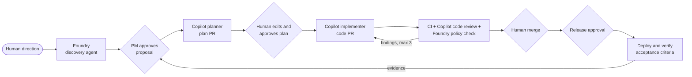

# Agentic SDLC with GitHub Copilot and Microsoft Foundry

A working demo of an agentic software lifecycle on a brownfield app. Humans set direction and approve at four gates. Agents on Microsoft Foundry and GitHub Copilot do the work in between and close the loop with evidence.

The app is [OctoCAT Supply](https://github.com/Azure-Samples/octocat-supply), an Express and SQLite API with a React frontend. It has a real bug the agents have to find: order lines are billed at the price the client sends, catalog discounts are ignored, and the documented order total is never returned.



| Who | Does what |
|---|---|
| Human | Writes the direction, approves the proposal, edits and approves the plan, merges, approves the release |
| Foundry discovery agent | Reads support tickets, feedback, and order data, then drafts a proposal with root cause and acceptance criteria |
| Copilot coding agent, `planner` | Turns the approved proposal into a plan PR |
| Copilot coding agent, `implementer` | Implements the pinned plan with tests and an acceptance check, and fixes findings |
| Copilot code review | Reviews every PR |
| Foundry policy check (Microsoft-Decision) | Checks PRs against this team's written standards with line-level evidence |
| GitHub Actions | Enforces the gates, runs the repair loop, deploys, and reports acceptance results to the PM |

## Start here

- [How it works](docs/agentic-sdlc/README.md): stages, gates, guardrails, what's implemented and what's still a gap
- [Setup](docs/agentic-sdlc/setup.md): Foundry, Azure OIDC, repo variables, GitHub settings
- [Demo script](docs/agentic-sdlc/demo-script.md): presenter walkthrough with offline rehearsal paths
- [Foundry policy check](docs/agentic-sdlc/policy-check.md): writing and promoting team rules

## Try it locally

```bash
# The app
cd api && npm ci && npm run dev          # seeds SQLite, API on :3000
cd frontend && npm ci && npm run dev     # UI on :5137

# The SDLC tooling (Python 3.9+)
pip install pyyaml
python3 -m unittest discover -s sdlc/tests -t .
python3 -m sdlc.policy_check --policy .github/policies/team-standards.yml \
  --diff docs/agentic-sdlc/sample-run/sample-pr.diff
```

## Layout

| Path | Contents |
|---|---|
| `api/`, `frontend/`, `infra/` | The brownfield app and its Container Apps bicep |
| `.github/copilot-instructions.md`, `.github/instructions/` | Custom instructions for Copilot |
| `.github/agents/` | `planner` and `implementer` custom agents |
| `.github/workflows/` | CI, discovery, gates, policy check, repair loop, deploy and verify |
| `.github/policies/team-standards.yml` | Team standards for the policy check |
| `docs/plans/` | Plan template; approved plans land here |
| `sdlc/` | Discovery runner, plan guard, policy checker, Decision client, evidence pack, tests |
| `acceptance/` | Acceptance harness run against production |

See [NOTICE](NOTICE) for attribution of the sample app.
