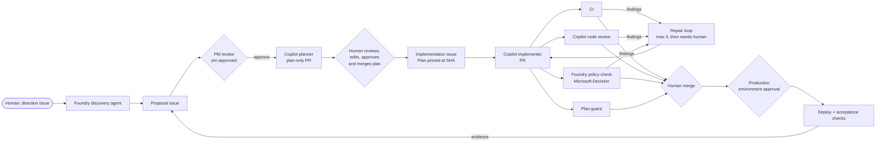

# Agentic SDLC on a brownfield app

Humans set direction and approve at four gates. Agents on Microsoft Foundry and GitHub Copilot do the work between gates and close the loop with evidence. The app is Octocat Supply, an existing TypeScript API and React frontend that we treat as brownfield code.

## The scenario

Branch managers say they're overcharged. The evidence pack in [`sdlc/evidence/order-discounts/`](../../sdlc/evidence/order-discounts/) shows why: `POST /api/order-details` trusts the `unitPrice` the client sends and ignores the product's catalog discount, and the documented `Order.totalAmount` is never returned. Four sample orders add up to 852.50 in overcharges. Nobody tells the agents this. They find it.

## Flow

## Stages, actors, and gates

| # | Stage | Who does it | Trigger | Output | Workflow |
|---|---|---|---|---|---|
| 1 | Direction | Human | Direction issue form | `direction` issue | [direction.yml](../../.github/ISSUE_TEMPLATE/direction.yml) |
| 2 | Discovery | Foundry agent `octocat-discovery` | `direction` label | `proposal` issue with ACs | [foundry-discovery.yml](../../.github/workflows/foundry-discovery.yml) |
| **G1** | **Proposal approval** | **PM** | adds `pm-approved` | approval comment with text digest | [request-plan.yml](../../.github/workflows/request-plan.yml) |
| 3 | Planning | Copilot coding agent, `planner` | assigned by G1 | plan-only PR `docs/plans/proposal-N-*.md` | [planner.agent.md](../../.github/agents/planner.agent.md) |
| **G2** | **Plan approval** | **Human** | reviews, edits, approves, merges | implementation issue with `Plan: path@sha` | [start-implementation.yml](../../.github/workflows/start-implementation.yml) |
| 4 | Implementation | Copilot coding agent, `implementer` | assigned by G2 | code PR, tests, `acceptance/proposal-N.mjs` | [implementer.agent.md](../../.github/agents/implementer.agent.md) |
| 5 | Checks | CI, Copilot code review, Foundry policy check, plan guard | every PR push | statuses and comments | [ci.yml](../../.github/workflows/ci.yml), [foundry-policy-check.yml](../../.github/workflows/foundry-policy-check.yml), [plan-guard.yml](../../.github/workflows/plan-guard.yml) |
| 6 | Repair | Copilot coding agent | failed check or review comments | new commits; `needs-human` after 3 tries | [agent-repair-loop.yml](../../.github/workflows/agent-repair-loop.yml) |
| **G3** | **Merge** | **Human** | approves and merges code PR | main updated | branch protection |
| **G4** | **Release** | **Human** | approves `production` environment | deployed apps | [deploy.yml](../../.github/workflows/deploy.yml) |
| 7 | Verification | GitHub Actions | after deploy | evidence on proposal; `verified` or `verification-failed` | [deploy.yml](../../.github/workflows/deploy.yml) |

## Guardrails

- **Plan approval is enforceable.** The plan guard rejects implementation PRs that don't name a plan file and SHA, where the SHA isn't on `main`, or where the plan changed since. It also rejects code PRs that sneak in plan edits, and plan PRs that touch code.
- **Approvals are checked, not assumed.** `pm-approved` from a bot or someone without write access is removed. A plan merged without a human approving review doesn't start implementation.
- **Trusted inputs come from the base branch.** The policy file, the checker, and the plan guard all run from the base commit. PR content is fetched as data and never executed by these workflows.
- **"Unavailable" is not "pass".** If Microsoft-Decision can't be reached, the check says UNAVAILABLE, posts a warning, and doesn't trigger agent repair. Set `POLICY_UNAVAILABLE_FAILS=true` to make it blocking.
- **Deterministic where possible.** Pattern rules (console.log, secrets, edited migrations, `any`) never call a model. Decision handles bounded per-file yes/no questions with line evidence, and rules stay advisory until validated. See [policy-check.md](policy-check.md).
- **Bounded autonomy.** The repair loop stops after `REPAIR_MAX_ATTEMPTS` (default 3), labels `needs-human`, and hands over.
- **Agents can't move the goalposts.** Custom instructions forbid editing plans, policies, workflows, or acceptance criteria to make checks pass.

## Implemented vs. planned

| Piece | State |
|---|---|
| Brownfield app, CI, Copilot setup steps | Implemented and tested locally |
| Custom instructions and `planner` / `implementer` agents | Implemented |
| Discovery runner, proposal schema, issue rendering | Implemented, offline tests pass. Live Foundry Agent SDK calls not yet run against a real project |
| Plan guard (plan-only rules, plan@SHA binding) | Implemented, tested |
| Policy checker, Decision client, batching, exit codes | Implemented, tested with a fake transport. Decision's probability field names need live validation |
| Discovery, request-plan, start-implementation, policy, repair, deploy workflows | Written and YAML-validated. Need a configured repo to run end to end |
| Acceptance harness | Implemented. Sample check fails 0/5 on the unfixed baseline, as expected |
| Production environment reviewers, Copilot code review ruleset, branch protection | Manual setup, see [setup.md](setup.md) |

## Known gaps

- The proposal issue can be edited after `pm-approved`. The approval comment records a digest of the approved text, but nothing blocks later edits yet.
- Workflows on PRs opened by the Copilot coding agent may wait for "Approve and run workflows", which is a human click.
- Fork PRs get no OIDC token, so the policy check reports UNAVAILABLE for them.
- Assigning Copilot and posting `@copilot` repair comments need a user token (`COPILOT_ASSIGN_TOKEN`); without it, the workflows post instructions for doing it by hand.
- Deployment verification covers the API only. There's no UI acceptance check.

## Files

| Path | Role |
|---|---|
| [`.github/copilot-instructions.md`](../../.github/copilot-instructions.md), [`.github/instructions/`](../../.github/instructions/) | Custom instructions every Copilot agent reads |
| [`.github/agents/`](../../.github/agents/) | `planner` and `implementer` custom agents |
| [`docs/plans/TEMPLATE.md`](../plans/TEMPLATE.md) | Plan structure the guard validates |
| [`.github/policies/team-standards.yml`](../../.github/policies/team-standards.yml) | Team standards for the Foundry policy check |
| [`sdlc/`](../../sdlc/) | Python for discovery, plan guard, policy check, Decision client, and tests |
| [`sdlc/agents/discovery-agent.md`](../../sdlc/agents/discovery-agent.md) | Foundry discovery agent instructions |
| [`acceptance/`](../../acceptance/) | Acceptance harness the implementer extends |
| [`sample-run/`](sample-run/) | Illustrative outputs for rehearsal |

Next: [setup.md](setup.md) to configure a repo, then [demo-script.md](demo-script.md) to present it.
